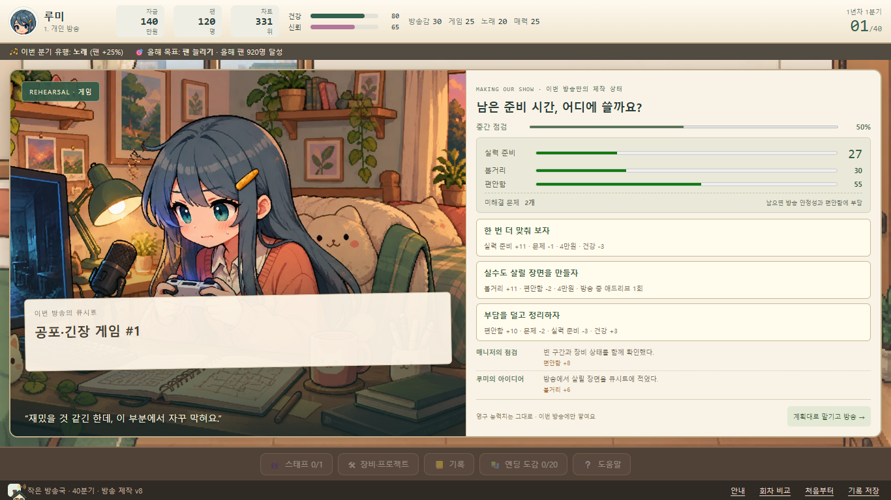
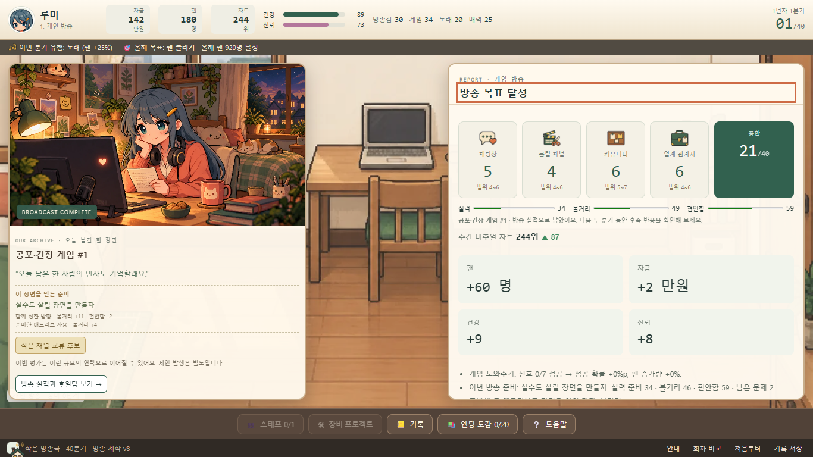

# 작은 방송국 - 버튜버 육성 프로토타입

**일정을 정하고 방송을 준비하며, 버튜버 루미의 10년을 매니저로 함께하는 웹 육성 게임입니다.**

[바로 플레이](https://digdagdac.github.io/vtuber-management-prototype/prototype/) · [기획 판단과 변경 과정](docs/DESIGN_DECISIONS.md) · [AI 제작 방식](docs/AI_WORKFLOW.md) · [구현과 검증](docs/VERIFICATION.md)



## 이 프로젝트에서 보여 주는 것

AI로 비교 가능한 프로토타입을 만들고 직접 플레이한 결과로 어떤 규칙과 화면을 남길지 판단했습니다. 포트폴리오에서는 **문제 설정 → 비교안 제작 → 직접 평가 → 수정 → 실행 확인** 과정을 중심으로 설명합니다.

현재는 미출시 개인 프로토타입이며, 2026년 9-10월의 기획·제작 기록을 공개용으로 정리했습니다.

## 먼저 세 번의 방송을 해 보세요

1. 연간 목표를 고른 뒤, 네 칸의 일정과 방송 주제·콘셉트를 정합니다.
2. 루미와 사건 대화를 진행하고 이번 방송의 제작 과정을 봅니다.
3. 중간에 실력 준비·볼거리·편안함 중 어떤 방향을 더 챙길지 고릅니다.
4. 생방송을 돕거나 스태프에게 맡기고, 결과에 준비와 선택이 어떻게 남았는지 확인합니다.
5. 다음 방송에서 같은 방침을 유지할지 바꿀지 정합니다.

PC 가로 화면을 권장합니다. 하단 안내에서는 제작 중간 과정을 생략하는 비교판도 열 수 있습니다. 비교판은 같은 규칙 일부를 공유하는 실험 경로이며, 과거 버전 전체를 동결한 빌드가 아닙니다.

## 제가 한 일과 AI가 한 일

| 주체 | 맡은 일 |
| --- | --- |
| 김혜성 | 게임의 목표·범위 설정, 비교할 입력 방식 결정, 직접 플레이와 피드백, 규칙·화면의 채택·폐기·수정 방향, 최종 품질 판단 |
| AI 협업 | 프로토타입 코드와 자동 검사 구현, 임시 이미지 제작, 수정안·원인 분석 보조 |

Codex·Claude Code·Cursor 등을 사용했고, 긴 작업에는 가재코드(GJC)·OMO 같은 외부 도구의 작업 조율 방식을 활용했습니다. 이 저장소는 해당 도구 자체를 개발했다는 의미가 아닙니다. [자세한 역할과 작업 흐름](docs/AI_WORKFLOW.md)을 함께 정리했습니다.

## 핵심 기획 변화

- 일정 입력 A 행동 칸 / B 비율 배분 / C 운영 방침을 비교했습니다. 직접 플레이 후 B를 제외하고 A 위에 C를 프리셋으로 결합했습니다.
- 짧은 육성 사이클에서 40분기로 확장하자 반복감이 커졌습니다. 기능 수를 늘리는 것과 다음 판단이 바뀌는 것은 다르다고 보았습니다.
- 영구 능력과 방송 한 편의 준비 상태를 나눴습니다. 제작 기여가 쌓이고 중간 방침을 고른 뒤, 준비한 요소가 생방송과 결과로 이어지도록 구성했습니다.
- 저장·새로고침으로 선택과 보상이 중복 적용되지 않도록 상태를 검사했습니다.



## 실행

게임 자체는 외부 패키지나 서버 없이 `prototype/index.html`을 Chrome 또는 Edge에서 열어 실행할 수 있습니다. 저장은 브라우저의 localStorage를 사용합니다.

로컬 HTTP 서버로 실행하려면 Node.js 22 이상에서:

```sh
npm start
```

출력되는 로컬 주소를 엽니다. `npm start`와 규칙 검사에는 별도 의존성 설치가 필요하지 않습니다.

## 검사

```sh
npm test
```

규칙·저장·보상·40분기 진행을 검사합니다. 브라우저 검사에는 Playwright가 필요합니다.

```sh
npm install
npx playwright install chromium
npm run test:browser
```

지원 준비 과정의 코드 사본에서 규칙 검사 **73개**, 방송 제작 브라우저 검사 **12개**를 다시 확인했습니다. 자세한 날짜·범위·실행 근거는 [검증 문서](docs/VERIFICATION.md)에 있습니다. 자동 검사는 재미 개선이나 외부 플레이어 반응을 입증하지 않습니다.

## 파일 안내

- `prototype/core.js`: 육성 상태, 일정, 진행, 방송과 저장 규칙
- `prototype/career.js`: 방송 실적, 후속 반응, 제안과 프로그램
- `prototype/workshop.js`: 방송 제작 상태, 기여와 중간 방침
- `prototype/app.js`: 화면 표시와 사용자 입력
- `prototype/assets/art/`: 실행용 임시 이미지와 manifest
- `prototype/tests/`: 규칙·브라우저 검사
- `docs/`: 기획 판단, AI 활용 방식, 검증 범위, 화면 자료

모든 과거 실험과 개인 작업 폴더를 올린 저장소가 아니라 현재 실행판과 설명에 필요한 근거를 모은 공개 사본입니다. 게임 플레이 코드의 독자적인 수동 구현 사례는 별도 프로젝트인 마녀의 시간·약초나라와 구분합니다.

작성자: [김혜성 / digdagdac](https://github.com/digdagdac)
